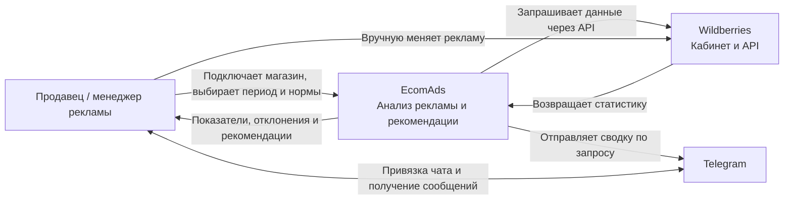
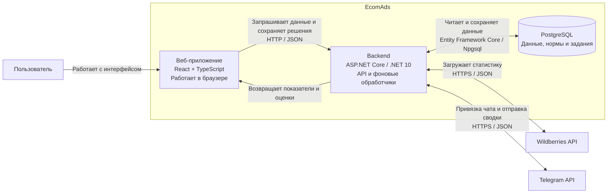
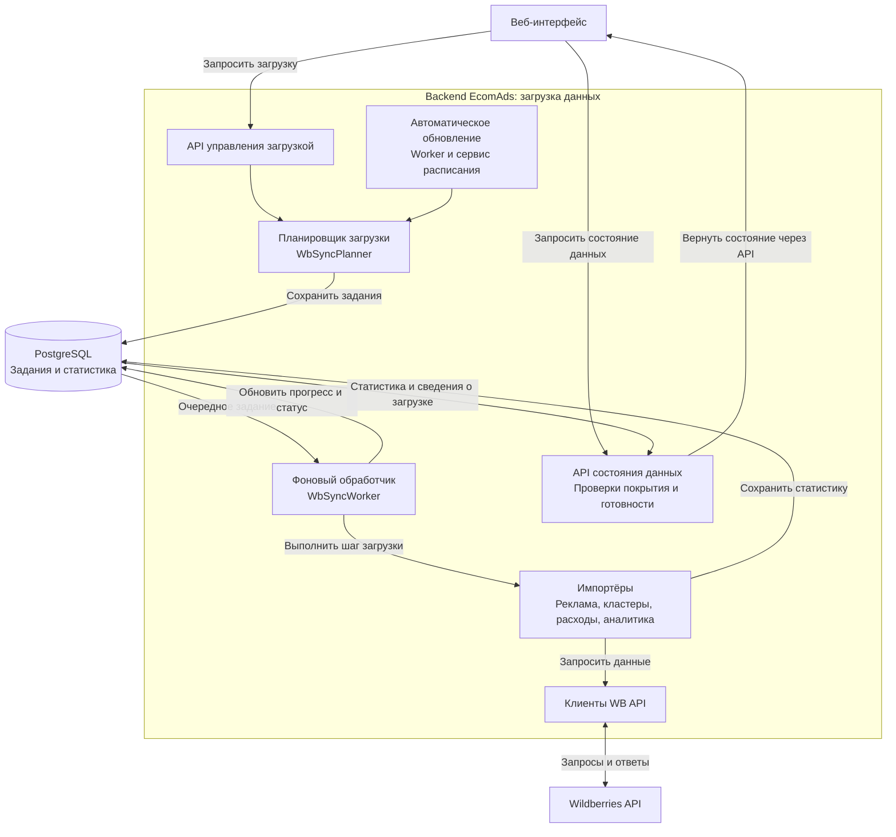
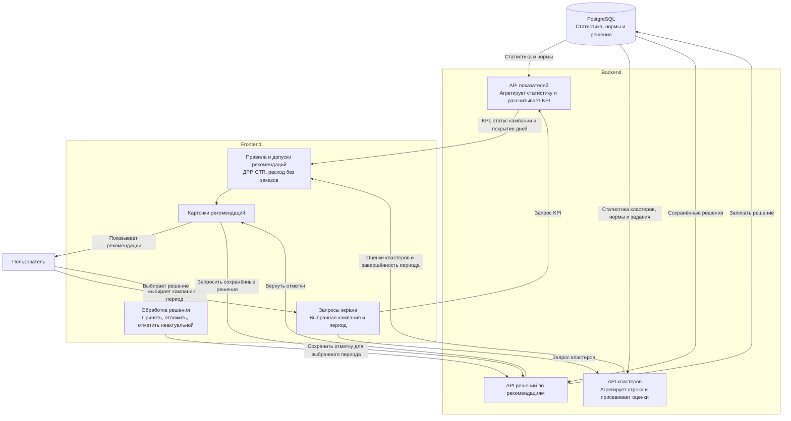

# EcomAds: четыре архитектурные схемы для домашнего задания

Дата описания: 12.10.2026. Основа — текущая реализация в репозитории. Наличие данных в конкретном кабинете и состояние развёрнутого приложения не проверялись.

**EcomAds собирает данные Wildberries, показывает показатели рекламы, находит отклонения от заданных норм и помогает пользователю решить, что проверить.**

## Как читать задание и переносить схемы

Context показывает систему снаружи: пользователей и внешние системы. Container раскрывает приложения и хранилища внутри системы. Component раскрывает ответственность внутренних модулей приложения. Контейнер C4 не обязательно является Docker-контейнером.

Ниже приведены готовые описания блоков, связей, примеры и Mermaid-код. Код задаёт содержание и направление связей; при переносе в Miro или FigJam расположение блоков можно менять.

Для оформления: человек — отдельная фигура пользователя; внутренние приложения и компоненты — синие прямоугольники; внешние системы — серые прямоугольники; база — цилиндр; границы — подписанные рамки. На каждом блоке укажите название и ответственность, а на Container и Component также технологию, где она известна. Стрелки подписывайте действием или передаваемыми данными. Для запросов и ответов допустимы две стрелки или одна двунаправленная связь с общей подписью.

## 1. Context Diagram — кто взаимодействует с EcomAds

**Вопрос схемы:** зачем существует продукт, кто им пользуется и откуда получает данные? Внутренние приложения, база и технологии здесь не показываются.

### Блоки

| Блок | Тип | Описание внутри блока |
|---|---|---|
| Продавец / менеджер рекламы | Пользователь | Анализирует рекламу магазина и принимает решения |
| EcomAds | Программная система | Анализ рекламы Wildberries и рекомендации |
| Wildberries | Внешняя система | Рекламный кабинет и API статистики |
| Telegram | Внешняя система | Получение сводки и привязка чата |

### Связи

- Пользователь → EcomAds: подключает магазин, выбирает период, настраивает нормы, изучает рекомендации и отмечает решения через веб-интерфейс.
- EcomAds → пользователь: показывает статистику, отклонения, ограничения данных и рекомендации.
- EcomAds → Wildberries: запрашивает данные магазина через API.
- Wildberries → EcomAds: возвращает сведения о кампаниях, рекламную статистику, кластеры, расходы и аналитику товаров.
- Пользователь → Wildberries: вручную меняет настройки рекламы в кабинете WB.
- EcomAds → Telegram: отправляет вчерашнюю сводку по запросу пользователя в приложении.
- Пользователь ↔ Telegram: привязывает чат и получает сообщения.

**Пример:** менеджер открывает EcomAds, замечает превышение нормы ДРР и переходит в кабинет WB, чтобы проверить ставки и состав кампании.

**Пояснение для защиты:** EcomAds помогает принимать решения на основе данных WB. В показанной цепочке рекомендации не меняют рекламу автоматически. Пользователь выполняет действие самостоятельно.

## 2. Container Diagram — из каких частей состоит система

**Вопрос схемы:** где работает интерфейс, где обрабатываются данные и где они хранятся?

### Основные блоки

| Блок | Технологии | Ответственность |
|---|---|---|
| Веб-приложение в браузере | React, TypeScript | Экраны магазина и кампании, графики, таблицы, формирование карточек рекомендаций |
| Backend | ASP.NET Core, .NET 10 | API, авторизация, агрегация статистики, оценки кластеров, загрузка данных и Telegram |
| База данных | PostgreSQL | Пользователи, магазины, кампании, статистика, нормы, задания загрузки и решения пользователя |

Эти три блока находятся внутри границы EcomAds. Пользователь, Wildberries API и Telegram API находятся снаружи. База хранит задания, поэтому отдельный брокер очередей не изображается.

**Техническая пометка рядом со схемой:** в конфигурации Docker Compose перед backend стоит Nginx. Собранные файлы frontend раздаёт ASP.NET Core. После загрузки frontend выполняется в браузере. Фоновые обработчики запускаются внутри backend, а задания хранятся в PostgreSQL. Nginx можно показать небольшим инфраструктурным блоком перед сервером; подробную схему развёртывания домашка не требует.

**Пример:** браузер запрашивает показатели кампании. Backend читает накопленную статистику из PostgreSQL, рассчитывает показатели и возвращает JSON. React отображает их и формирует карточки рекомендаций. Такой запрос не обязательно вызывает новую загрузку из WB.

### Обоснование архитектуры и технологий

Текущий backend организован как монолит. Для MVP это позволяет развивать API, расчёты и загрузку данных в одном приложении, использовать общую базу и обходиться без взаимодействия нескольких самостоятельных сервисов. Недостаток такой структуры — общий процесс для API и фоновых обработчиков; независимое масштабирование этих частей потребовало бы изменения архитектуры.

React подходит для интерактивного интерфейса с фильтрами, таблицами и графиками. ASP.NET Core объединяет HTTP API, авторизацию, внедрение зависимостей и фоновые обработчики. PostgreSQL хранит связанные сущности и историю статистики; Entity Framework Core используется для доступа к данным и миграций.

Это объяснение пригодности технологий для проекта, а не утверждение об исторических причинах их выбора. Отдельная база и Nginx не превращают backend в микросервисную систему.

## 3. Component Diagram — загрузка и подготовка данных Wildberries

**Почему выбран модуль:** рекомендации зависят от того, какие данные загружены и насколько они полные.

**Граница схемы:** компоненты backend. Веб-интерфейс, база и WB API показаны как внешние по отношению к этому контейнеру блоки. База остаётся частью EcomAds на предыдущем уровне.

### Компоненты

| Компонент | Реализация / ответственность |
|---|---|
| API управления загрузкой | Контроллеры подключения магазина и запуска синхронизации |
| Автоматическое обновление | `WbAutoRefreshWorker` и `WbScheduledRefreshService`: планирование обновлений при включённой настройке |
| Планировщик загрузки | `WbSyncPlanner`: формирование заданий с периодами и объектами загрузки |
| Фоновый обработчик | `WbSyncWorker`: выбор заданий из базы и выполнение по шагам |
| Клиенты WB API | `WbPromotionClient`, `WbJamClient`, `WbSalesFunnelClient`: запросы к соответствующим API |
| Импортёры | Загрузка и сохранение рекламной статистики, кластеров, расходов, воронки и аналитики Джема |
| Проверки покрытия и готовности | `WbDataCoverageService`, `WbReportReadinessService` и API состояния данных |

Это основной поток загрузки статистики. Отдельные операции, например обновление списка кампаний, могут обращаться к WB непосредственно из планировщика; схема не утверждает, что любой запрос WB обязательно проходит через импортёр.

Рядом с обработчиком подписать: **учитывает ограничения запросов, откладывает повторные попытки, сохраняет прогресс и ошибки**. Автоматическое обновление работает при включении соответствующих настроек; наличие обработчика в коде не доказывает его включение на сервере.

**Пример работы:** пользователь запрашивает статистику за неделю. Планировщик сохраняет задания. Обработчик загружает данные по шагам, импортёры записывают их в базу. Интерфейс отдельно запрашивает статистику и состояние загрузки.

**Важное пояснение:** завершённое задание, наличие всех показателей и достаточный объём статистики — разные свойства. Завершение загрузки само по себе не доказывает достаточность данных для рекомендации. Проверки готовности отчёта не являются общей обязательной проверкой перед всеми рекомендациями.

## 4. Component Diagram — как сейчас формируются рекомендации

**Почему выбран модуль:** он показывает, как статистика превращается в полезный для пользователя вывод.

Текущая логика распределена между backend и frontend. На рисунке нужны две подписанные области. Строгий C4 Component обычно раскрывает один контейнер; здесь дан общий вид взаимодействия компонентов двух контейнеров. Для строгого оформления можно разделить рисунок на две панели, оставив компоненты второго контейнера внешними соседями каждой панели.

### Компоненты и поток данных

| Компонент | Ответственность |
|---|---|
| API показателей | Чтение статистики, агрегация KPI и получение норм магазина/кампании |
| API кластеров | Агрегация строк за период, оценка кластера и определение флага завершённости |
| Правила рекомендаций во frontend | `campaignRecommendations`, `clusterRecommendations` и допуски экрана кампании |
| Карточки рекомендаций | `RecommendationList`: показ объяснения, действия и сохранённого решения |
| API решений | Чтение и сохранение отметок для пользователя, ключа рекомендации и выбранного периода |

### Действующие правила

| Правило | Условие | Рекомендация |
|---|---|---|
| Высокий рекламный ДРР | Сумма рекламных заказов > 0; ДРР строго выше цели | Проверить ставки и состав кампании |
| Низкий CTR | Показы > 0; CTR строго ниже нормы | Проверить объявления и соответствие запросам |
| Расход кластера без заказов | Расход ≥ минимального расхода; клики ≥ минимума кликов; заказы = 0 | Проверить релевантность кластера, карточку товара и настройки рекламы в WB |

Первые два правила требуют текущего статуса WB `9` (активна) и `coverageDays > 0`. При `coverageDays < expectedDays` карточки помечаются как предварительные. Равенство ДРР или CTR норме не создаёт рекомендацию. Правила независимы: кампания может получить обе карточки. Дополнительного минимума кликов или расходов для этих двух правил сейчас нет.

Кластерная карточка требует оценки «Расход без заказов — проверить», активной кампании и `isPeriodComplete = true`. Оценка строки рассчитывается на backend, а карточка создаётся на frontend. Нормы берутся из настройки кампании, затем магазина, затем значений по умолчанию. Для оценки кластеров значения по умолчанию: 500 ₽ расхода, 30 кликов и 3 заказа; минимум заказов применяется в оценке недостаточности данных.

### Как backend оценивает строку кластера

Проверки идут по порядку; возвращается первая подходящая оценка:

1. Нет кликов или заказов → «Показатели неполные».
2. Достигнуты минимальные расход и клики, заказов нет → «Расход без заказов — проверить».
3. Расход, клики и заказы одновременно ниже своих минимумов → «Недостаточно данных».
4. Остальные случаи → «Наблюдать: выручка кластера недоступна».

Оценка строки сама по себе не всегда становится рекомендацией. Наличие отдельной расчётной оценки суммы заказов не меняет перечисленные проверки.

### Пример прохождения данных

Активная кампания за полностью загруженный период:

- Расход: **4 000 ₽**.
- Сумма рекламных заказов: **10 000 ₽**.
- Цель ДРР: **30%**.
- Рассчитанный ДРР: **4 000 / 10 000 × 100 = 40%**.

Backend возвращает показатели и норму. Frontend сравнивает 40% с 30% и создаёт карточку: **«Проверьте ставки и состав кампании»**. При принятии система сохраняет отметку пользователя. Это не подтверждает изменение настроек в WB или улучшение результата.

Другой пример: кластер потратил 600 ₽, получил 35 кликов и 0 заказов. При стандартных порогах backend присваивает оценку «Расход без заказов — проверить». Карточка появится на экране кампании, если кампания активна и флаг завершённости периода установлен.

### Ограничения, которые нужно подписать рядом со схемой

- Карточки создаются фиксированными правилами; LLM в текущей цепочке не участвует.
- Сумма рекламных заказов не равна выручке от выкупленных товаров или прибыли.
- При нулевой сумме рекламных заказов правило высокого ДРР не срабатывает.
- Отсутствие карточек не означает, что вся реклама эффективна.
- «Проверьте релевантность» — предложенная проверка, а не обнаруженная системой нерелевантность.
- Оценочная сумма заказов и оценочный ДРР кластера не являются фактическими показателями и не используются перечисленными правилами.
- `isPeriodComplete` для рекомендаций определяется наличием завершённого задания на весь период, содержащего пару с кампанией. Это не проверка покрытия всех товаров кампании; несколько заданий с составным покрытием здесь не объединяются.
- Кампании в рекомендациях сортируются по названию, кластерные карточки наследуют порядок строк по расходу. Общей оценки приоритета или потенциальной экономии нет.
- «Отложить» сохраняет статус; в этой цепочке это не назначение времени напоминания. Решение можно отменить.
- Telegram-сводка имеет отдельную логику превышения ДРР и не воспроизводит весь список рекомендаций интерфейса.

## Проверка визуализаций и объяснение на защите

Схемы должны позволять проследить цепочку: **пользователь → загрузка WB → сохранённая статистика → расчёты → правила → рекомендация → решение пользователя**.

| Проверка | Ожидаемый смысл схемы |
|---|---|
| Context | Понятны пользователь, назначение продукта и внешние системы; внутренних компонентов нет |
| Container | Понятны браузер, backend и база; фоновые обработчики находятся внутри backend |
| Загрузка | Видны отдельные этапы планирования, выполнения, сохранения и проверки состояния данных |
| Рекомендации | Видна граница frontend/backend и отдельное сохранение решений |
| Высокий ДРР | 40% при цели 30% создаёт рекомендацию при выполнении допуска |
| Низкий CTR | Есть показы, CTR ниже нормы, кампания активна и есть покрытие → карточка |
| Расход без заказов | 600 ₽ / 35 кликов / 0 заказов → оценка; карточка дополнительно зависит от допуска |
| Неполный период | Кампанийные карточки могут быть предварительными; при ложном флаге завершённости кластерные карточки не создаются |
| Отсутствующие показатели | Нет кликов или заказов кластера → неполные показатели, без карточки расхода без заказов |
| Ноль суммы заказов | Правило высокого ДРР не срабатывает; это не вывод об эффективности |
| Принятие рекомендации | Сохраняется отметка пользователя, настройки WB не меняются |

Краткое объяснение для защиты: «Сначала я показываю окружение EcomAds, затем его приложения и базу. Для детализации выбрал загрузку данных и рекомендации: первый модуль обеспечивает факты, второй превращает их в сигналы. В текущей реализации сервер считает показатели и оценки кластеров, а frontend формирует карточки по правилам. Пользователь самостоятельно проверяет рекламу и отмечает решение».

## Источники в репозитории

Источником текущего поведения служит код. Старые планы интеграции LLM не считаются доказательством работающего функционала.

- [Регистрация сервисов, фоновых обработчиков и раздача frontend](../../Ecomads.WebApplication/Program.cs)
- [Технологии backend](../../Ecomads.WebApplication/Ecomads.WebApplication.csproj), [технологии frontend](../../Ecomads.WebApplication/ClientApp/package.json), [Docker Compose](../../docker-compose.yml)
- [Планировщик загрузки](../../Ecomads.WebApplication/Services/Wb/WbSyncPlanner.cs), [обработчик заданий](../../Ecomads.WebApplication/Services/Wb/WbSyncWorker.cs), [автоматическое обновление](../../Ecomads.WebApplication/Services/Wb/WbScheduledRefreshService.cs)
- [Показатели и нормы кампаний](../../Ecomads.WebApplication/Controllers/ProjectsController.cs)
- [Оценки и расчётные показатели кластеров](../../Ecomads.WebApplication/Controllers/WbCampaignClustersController.cs)
- [Правила карточек](../../Ecomads.WebApplication/ClientApp/src/shared/lib/recommendations.ts), [допуски экрана кампании](../../Ecomads.WebApplication/ClientApp/src/pages/CampaignPage/CampaignPage.tsx)
- [Карточки и действия пользователя](../../Ecomads.WebApplication/ClientApp/src/shared/ui/RecommendationList.tsx), [сохранение решений](../../Ecomads.WebApplication/Controllers/WbRecommendationDecisionsController.cs)
- [Отправка Telegram-сводки](../../Ecomads.WebApplication/Controllers/TelegramController.cs)
- [Подробная бизнес-карта рекомендаций с оговоркой о последующих оценках кластеров](../expert-review/current-recommendation-business-map.md)
